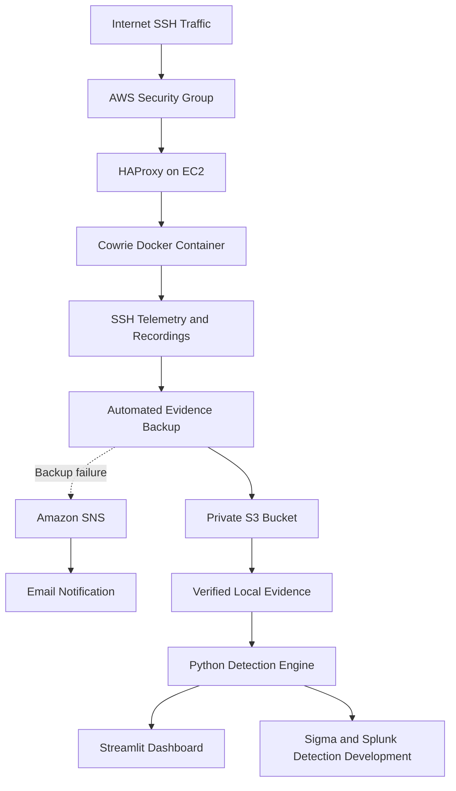
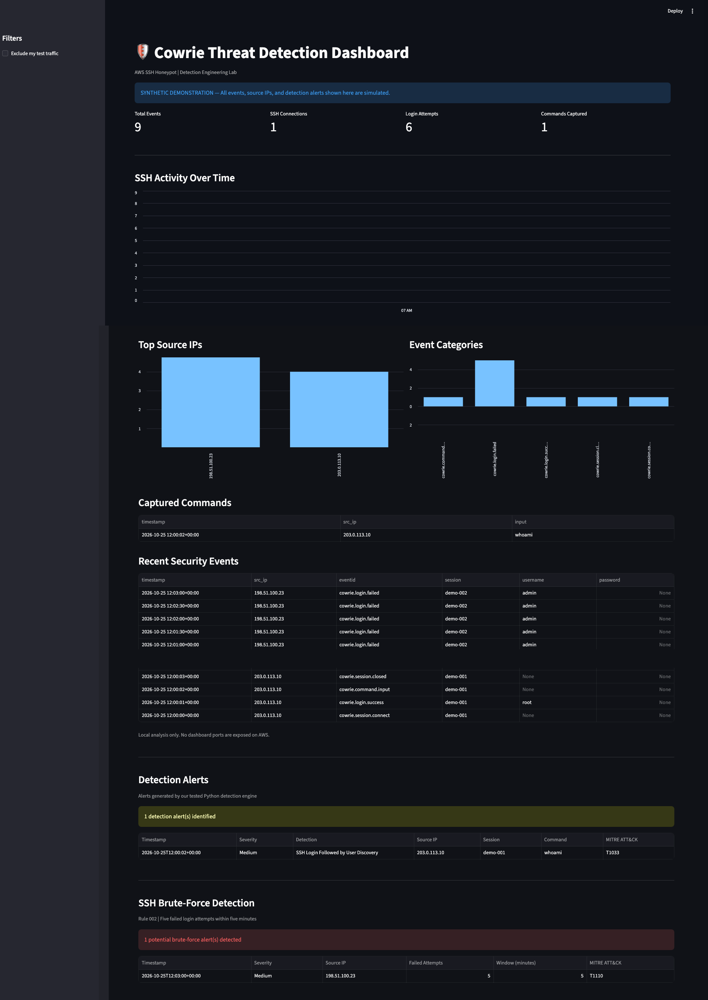

# AWS Cloud Honeypot & Detection Engineering Lab

An end-to-end cybersecurity portfolio project demonstrating AWS cloud security, SSH honeypot deployment, threat detection, evidence preservation, and security investigation.

## Project Overview

This project deploys a Cowrie SSH honeypot in AWS to observe unsolicited SSH activity and develop practical detection engineering capabilities.

The environment captures SSH authentication activity, session metadata, and commands. Evidence is preserved in Amazon S3 and analyzed locally using Python and Streamlit.

The project includes tested detection rules, Sigma correlation specifications, Splunk SPL queries, and a documented security investigation.

## Technologies

- AWS EC2, VPC, IAM, Systems Manager
- Amazon S3 and Amazon SNS
- Ubuntu Linux
- Docker and Docker Compose
- Cowrie SSH Honeypot
- HAProxy
- Python and unittest
- Streamlit and pandas
- Sigma and pySigma
- Splunk SPL
- MITRE ATT&CK

## Architecture



Detailed infrastructure and security documentation:

[Architecture and Security Design](docs/architecture.md)

## Security Architecture

The honeypot intentionally exposes TCP port 22 to observe unsolicited SSH traffic.

To reduce the risk associated with this exposure:

- HAProxy handles incoming SSH connections.
- The real Ubuntu SSH service and socket are masked.
- EC2 administration uses AWS Systems Manager.
- Cowrie runs in an unprivileged Docker container.
- All Linux capabilities are dropped.
- No-new-privileges is enabled.
- Process count is limited.
- The Docker network is internal.
- No Docker container ports are published on the host.
- IMDSv2 is required.
- EBS storage is encrypted.

These controls reduce exposure but do not eliminate all risks associated with running an internet-facing honeypot.

## Detection Engineering

### Rule 001: SSH Login Followed by User Discovery

Identifies user-discovery commands after successful simulated SSH authentication within the same session.

Supported commands include:

- whoami
- id
- who
- w

MITRE ATT&CK: T1033 — System Owner/User Discovery

### Rule 002: Repeated SSH Authentication Failures

Detects five failed SSH authentication attempts from the same source IP within five minutes.

MITRE ATT&CK: T1110 — Brute Force

## Automated Testing

The project includes 16 automated detection tests.

Test coverage includes:

- Valid detection scenarios
- Detection thresholds
- Event ordering
- Session correlation
- Source IP correlation
- Authorized test traffic exclusions
- Events outside detection time windows
- Session closure behavior

Run all tests:

```bash
python3 -m unittest discover -s tests -v
```

Last verified result:

16 tests passed.

## Sigma Detection Rules

Both detection scenarios have Sigma correlation specifications.

Validate the rules:

```bash
sigma check sigma/
```

The Sigma CLI validation completed with:

- 0 errors
- 0 condition errors
- 0 issues

## Splunk Compatibility

The project includes Splunk SPL queries for both detections.

The brute-force Sigma rule successfully converted into SPL.

The installed Splunk backend does not support automatic conversion of temporal_ordered correlation, so a native SPL query was created for the user-discovery detection.

Important limitations:

- The generated brute-force query uses fixed five-minute buckets.
- The Python detector uses a sliding five-minute window.
- Native Splunk queries have not been executed against an actual Splunk deployment.

See:

[Detection Compatibility Report](docs/detection-compatibility.md)

## Security Investigation

A captured SSH session included:

1. Connection to the Cowrie honeypot.
2. Successful simulated authentication as root.
3. Execution of the whoami command.
4. Detection of user-discovery activity.

The Python detection engine generated one medium-severity alert.

The evidence supports user-discovery activity within the honeypot, not compromise of the underlying EC2 host.

Full investigation:

[Security Investigation Report](docs/investigation-report.md)

## Evidence Preservation

The project implements:

- Daily automated Cowrie evidence backups
- Private S3 evidence storage
- SHA-256 archive checksums
- Local integrity verification
- S3 versioning and lifecycle configuration
- Backup-failure notifications through Amazon SNS

Raw evidence and session recordings are intentionally excluded from the public repository.

## Local Dashboard

The Streamlit dashboard provides:

- SSH event analysis
- Connection and authentication metrics
- Captured command activity
- Source IP information
- Detection alerts
- Filtering of known authorized test traffic

To start the dashboard from the project directory after installing its dependencies:

```bash
python3 -m streamlit run dashboard.py --server.address 127.0.0.1
```

The dashboard requires a local Cowrie evidence dataset. Raw evidence is not distributed with this repository.

## Project Documentation

- [Architecture](docs/architecture.md)
- [Security Investigation](docs/investigation-report.md)
- [Detection Compatibility](docs/detection-compatibility.md)

## Known Limitations

- Cowrie is intentionally exposed to unsolicited SSH traffic.
- The container root filesystem is writable.
- Independent missed-backup monitoring is not implemented.
- The dashboard uses locally collected evidence snapshots.
- The Python and generated Splunk detection windows are not identical.
- Splunk queries have not been validated against live ingested data.

## Future Improvements

Potential enhancements include:

- Live SIEM ingestion
- Additional detection scenarios
- Independent S3 backup freshness monitoring
- Automated alert enrichment
- Detection performance evaluation
- Infrastructure as Code

## Disclaimer

This project is intended for authorized cybersecurity research, defensive security engineering, and educational purposes.

The honeypot operates within infrastructure controlled by the project owner.

Captured attacker commands and payloads must be treated as untrusted content and must never be executed without appropriate isolation and authorization.

---

## Dashboard Preview — Synthetic Demonstration

The screenshot below demonstrates the detection engine using nine synthetic Cowrie SSH events. No real attacker data or personal IP addresses are included.



### Demonstration Results

| Detection | Result | MITRE ATT&CK |
|---|---|---|
| SSH Login Followed by User Discovery | 1 alert | T1033 |
| Repeated SSH Authentication Failures | 1 alert | T1110 |

### Run the Synthetic Demonstration

From the project directory:

1. Install dependencies:

```bash
python3 -m pip install -r requirements.txt
```

2. Generate synthetic SSH events:

```bash
python3 -m examples.generate_demo
```

3. Launch the demonstration dashboard:

```bash
COWRIE_DEMO_MODE=1 python3 -m streamlit run dashboard.py --server.address 127.0.0.1 --server.port 8502
```

4. Open http://127.0.0.1:8502 in your browser.

The synthetic dataset uses reserved documentation IP addresses. Real Cowrie evidence remains private and is not included in the repository.
