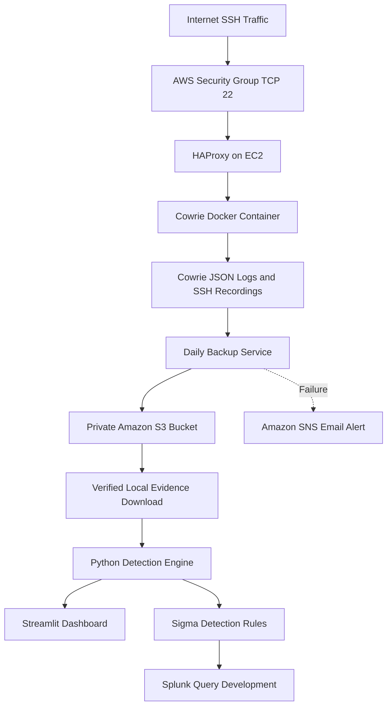

# AWS Cloud Honeypot — Architecture and Security Design

## Project Objective

Build an isolated AWS SSH honeypot to capture untrusted
SSH activity, preserve evidence, develop detection rules,
and investigate suspicious behavior.

## Architecture

## AWS Infrastructure

- AWS Region: us-east-2 (Ohio)
- EC2: Ubuntu 24.04
- VPC: Dedicated honeypot VPC and public subnet
- Public exposure: TCP port 22
- Administration: AWS Systems Manager Session Manager
- Evidence storage: Private Amazon S3 bucket

## Security Architecture

### Host Protection

- Real Ubuntu SSH service and socket are masked.
- HAProxy handles incoming SSH connections.
- IMDSv2 is required.
- Root EBS storage is encrypted.
- Administration does not require public SSH access.

### Container Isolation

- Cowrie runs in Docker without privileged mode.
- All Linux capabilities are dropped.
- Privilege escalation is restricted.
- Maximum processes: 128.
- Docker network is internal.
- No Docker ports are published on the host.
- The container root filesystem remains writable.

### Evidence Preservation

- Cowrie collects JSON events and SSH session recordings.
- A systemd timer starts daily backups at 12:00 UTC.
- Evidence archives are uploaded to private Amazon S3.
- SHA-256 checksums support integrity verification.
- S3 versioning and lifecycle policies are configured.

### Monitoring

- Backup failures trigger a systemd notification service.
- The notification service publishes messages to Amazon SNS.
- SNS email delivery has been successfully tested.
- Independent missed-backup monitoring is not implemented.

## Detection Engineering

### Detection 001: User Discovery

Detects a simulated successful SSH login followed by
user-discovery commands within the same session.

MITRE ATT&CK: T1033

### Detection 002: SSH Brute Force

Detects five failed SSH login attempts from the same
source IP within five minutes.

MITRE ATT&CK: T1110

Both detection rules include Python implementations,
automated unit tests, and validated Sigma specifications.

## Known Limitations

- The honeypot is intentionally exposed to internet traffic.
- The Cowrie container has a writable root filesystem.
- Backup failures are monitored, but missed schedules are not.
- The Python and Splunk brute-force time windows differ.
- The Splunk Sigma backend does not support temporal_ordered correlation.
- Native Splunk queries have not been tested against a live Splunk deployment.

## Security Considerations

- Never execute attacker-supplied commands or payloads.
- Keep raw evidence and SSH recordings out of public GitHub repositories.
- Keep the Streamlit dashboard accessible locally.
- Review AWS costs and internet exposure periodically.
- Preserve evidence before terminating cloud resources.
